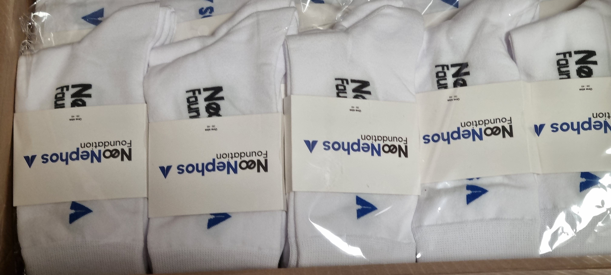

# Merchandise

NeoNephos offers branded merchandise for itself and its projects.

> [!Hint]
> NeoNephos projects might also autonomously procure project branded merchandise on their own initiative. This section only concerns itself with merchandise organized by the foundation.

## How to request merchandise?


Fill out the ```Request Merchandise``` issue template in the [repository of the Outreach Committee](https://github.com/neonephos/outreach/issues).

> [!Warning]
> Filling out the [issue template](https://github.com/neonephos/outreach/issues) is the only accepted way to request merchandise from NeoNephos. Contacting NNF staff via Zulip or related channels does not replace submitting this form.

### Who can request merchandise?

*Anyone* can submit a request. Chances of approval are highest if the request relates to:

- Events related to NeoNephos (either in attendance or hosting)
- NeoNephos Ambassadors
- Contributors to NeoNephos or its projects

## Where can I view available merchandise types?



The current stock of available merchandise types can be seen [here](https://github.com/neonephos/outreach/blob/main/topics/merch/inventory/stock_of_nonallocated_merchandise.csv).

> [!Tip]
> Images of the items from the list can be viewed [here](https://github.com/neonephos/outreach/tree/main/topics/merch/images).

## Where can I view current stock?

The current stock of available merchandise can be seen [here](https://github.com/neonephos/outreach/blob/main/topics/merch/inventory/stock_of_nonallocated_merchandise.csv).

> [!Note]
> The [stock_of_nonallocated_merchandise table](https://github.com/neonephos/outreach/blob/main/topics/merch/inventory/stock_of_nonallocated_merchandise.csv) does not count merchandise stock that has already been allocated for events. Only available merch is listed.

## When is merchandise procured?

The budget for merchandise is usually set once a year as part of the [yearly NeoNephos budget](./../relations_to_other_committees/governing_board_budget_requests_yearly_outreach_committee_budget.md).
